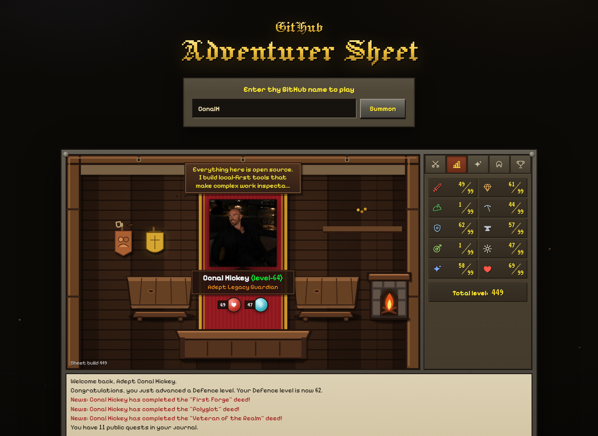

# GitHub Adventurer Sheet

[](https://github.com/Conalh/github-adventurer-sheet/actions/workflows/ci.yml)
[](LICENSE)
[](https://osrshub.pages.dev)

Enter thy GitHub name to play.

GitHub Adventurer Sheet turns any public GitHub profile into a deterministic
old-school MMO character sheet. Repositories become quests and equipment;
languages, stars, followers, and account history become skills, levels, deeds,
and trophies. The same public profile always rolls the same hero.

**[Summon an adventurer](https://osrshub.pages.dev)** or open a shareable route
such as [`/character/ConalH`](https://osrshub.pages.dev/character/ConalH).



## What is in the client?

- **Inn viewport** - a profile avatar, overhead bio, combat level, status orbs,
  original CSS scenery, skillcapes, and repository trophies.
- **Skills** - ten stats derived from distinct public profile signals and mapped
  onto the community-documented RuneScape XP curve.
- **Equipment** - starred, forked, recent, and language-dominant repositories
  become deterministic items with rarity tiers.
- **Quest journal** - notable repositories become quests with difficulty and
  quest-point values.
- **Deed diary** - fourteen achievements show completed or live progress.
- **Shareable routes** - every character lives at `/character/{username}`.

## Privacy and data

The app is entirely browser-side. It requests only public data from GitHub:

```text
GET https://api.github.com/users/{username}
GET https://api.github.com/users/{username}/repos?per_page=100&sort=updated
```

Repository pagination is handled up to 300 repositories. Results are cached in
`localStorage` for ten minutes. There is no login, analytics, tracking, server
database, or frontend token. Unauthenticated GitHub API rate limits still
apply.

Accepted input forms include:

```text
ConalH
@ConalH
github.com/ConalH
https://github.com/ConalH
```

## Run locally

Requires Node.js 22.12 or newer.

```sh
npm ci
npm run dev
```

Then open the local URL printed by Vite.

## Verify a change

```sh
npm test
npm run build
```

The suite covers profile parsing, caching, pagination, level scaling, XP
interpolation, combat-level clamping, quests, equipment, achievements, trophy
placement, missing API fields, and component rendering.

## How it works

```text
GitHub REST API
      |
      v
public profile + repositories
      |
      v
deterministic scoring and classification
      |
      v
React character sheet + shareable route
```

No random values or hidden server state are involved. The transformation logic
lives in `src/lib/githubCharacter.ts`, `src/lib/equipment.ts`, and
`src/lib/trophyRoom.ts`; the rendered client lives under `src/components/`.

## Parody and assets

This is an independent, fan-made parody. It is not affiliated with, endorsed
by, or connected to GitHub, Jagex, or RuneScape.

No game assets are used. Panels, borders, icons, trophies, equipment, and the
inn scene are original CSS and inline SVG. Pixelify Sans and Jacquard 12 are
open-licensed font packages; the bundled digits-only VT323 subset includes its
OFL license in `src/assets/VT323-LICENSE`.

## Contributing and license

Contributions are welcome; see [CONTRIBUTING.md](CONTRIBUTING.md). Security
reports belong in [private vulnerability reporting](SECURITY.md), not a public
issue.

The original code and artwork in this repository are available under the
[MIT License](LICENSE). Third-party trademarks and font licenses remain with
their respective owners.
